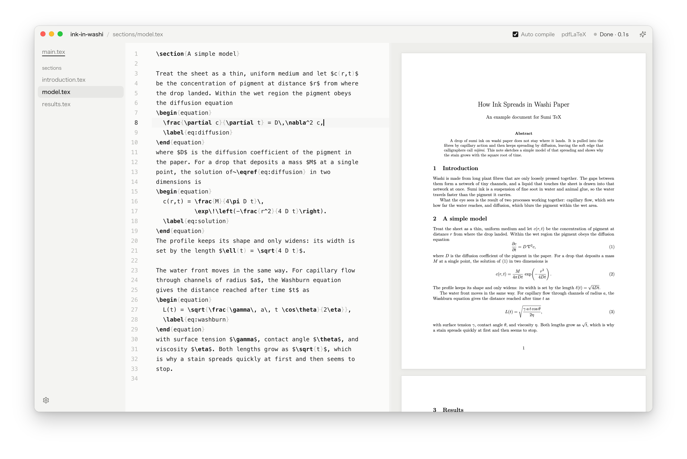
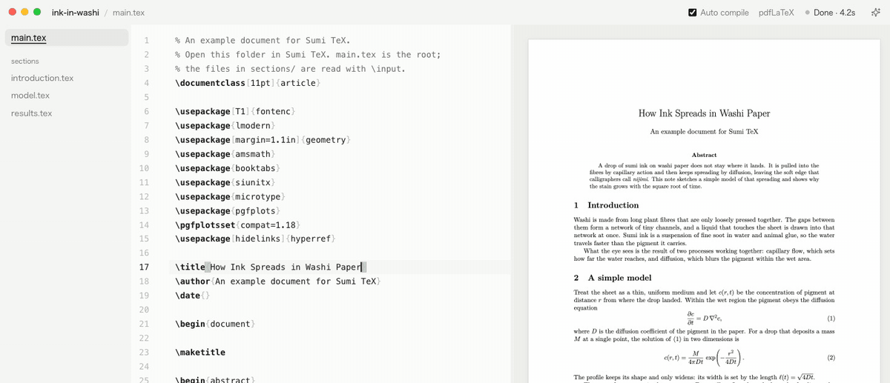

<p align="center">
  
</p>

<h1 align="center">Sumitex</h1>

<p align="center">
  静かな LaTeX エディター（macOS）。左で書いて、右で PDF を見る。1 つの画面で。
</p>

<p align="center">
  <a href="https://github.com/nogu66/sumitex/actions/workflows/ci.yml"></a>
  
  <a href="LICENSE"></a>
</p>

<p align="center">
  <a href="README.md">English</a> · 日本語
</p>

<p align="center">
  <picture>
    <source media="(prefers-color-scheme: dark)" srcset="docs/images/sumi-dark.png" />
    
  </picture>
</p>

> [!NOTE]
> Sumitex はまだ開発の初期段階です。macOS で動き、Apple シリコンで確認しています。

## なぜ Sumitex か

Sumitex は、書くことの邪魔をしない LaTeX エディターです。名前は墨（sumi）から取りました。

- **手元の TeX のまま。** 今ある `latexmk` でコンパイルし、`.latexmkrc` にも従うので、今のプロジェクトがそのまま動きます。Sumitex 自体は何もアップロードしません。
- **1 つの窓で、設定なしに。** フォルダを開けば書き始められます。打つたびに PDF が追いかけ、SyncTeX で行き来できます。
- **AI は使いたい人だけ。** Claude Code や Codex など好きなエージェントに、開いている書類を文脈として渡して頼めます。使わないなら AI パネルを切れば、ないものとして扱えます。

## できること

<p align="center">
  
</p>

- エディターと PDF を横に並べて表示。コンパイルし直してもちらつかず、スクロール位置も保つ
- *自動コンパイル*: 入力が 1.2 秒止まったら保存してコンパイル
- エラーはエディターと「問題」の一覧に出る
- SyncTeX の行き来: ⌘J でカーソル位置を PDF で示し、PDF を ⌘ クリックするとソースへ
- `% !TEX root`・`.latexmkrc`・処理系の自動選択に対応した、複数ファイルの書類
- ほかのエディターやエージェントがファイルを変えると、読み直してコンパイルし直す
- 明るさはライト・ダーク・システム、配色は紙・苔・砂の 3 つ
- 画面は英語と日本語

## 入れ方

Apple シリコンの Mac（macOS 12 以降）で動きます。

[Homebrew](https://brew.sh) で入れる場合:

```bash
brew install --cask nogu66/tap/sumitex
```

インストール用のスクリプトでも入れられます（`/Applications` に `Sumitex.app` を置きます）:

```bash
curl -fsSL https://raw.githubusercontent.com/nogu66/sumitex/main/install.sh | bash
```

更新も同じです。`brew upgrade --cask sumitex` か、スクリプトをもう一度実行してください。

[最新のリリース](https://github.com/nogu66/sumitex/releases/latest) から `.dmg` を落として入れることもできます。ただ、まだ Apple の公証を受けていないので、落とした `.dmg` のアプリは初回に macOS に止められます。一度開こうとしてから、**システム設定 → プライバシーとセキュリティ** で **このまま開く** を押してください。Homebrew とスクリプトなら、この手順は要りません。

### 自分でビルドする

[Node.js](https://nodejs.org) 22 以上が要ります。

```bash
git clone https://github.com/nogu66/sumitex.git
cd sumitex
npm install
npm run dist      # release/mac-arm64/Sumitex.app ができる
```

### TeX

書類のコンパイルには、`latexmk` と `synctex` を含む TeX（[MacTeX](https://www.tug.org/mactex/) など。`brew install --cask mactex-no-gui` で入ります）が要ります。TeX は `/Library/TeX/texbin` から、ほかの道具はログインシェルの `PATH` から探すので、Finder から開いても動きます。

## 使い方

⌘O でフォルダ（または `.tex` ファイル）を開くと、本体の書類を見つけてコンパイルします。試すなら、複数のファイルに分けた短い論文の [`examples/sample`](examples/sample) を開いてください。

| 操作 | キー |
| --- | --- |
| フォルダや `.tex` を開く | ⌘O |
| 保存してコンパイル | ⌘S（*自動コンパイル* なら自動） |
| コンパイル | ⌘R |
| カーソル位置を PDF で示す | ⌘J |
| PDF からソースへ飛ぶ | PDF を ⌘ クリック |
| ファイル一覧 / 問題の一覧 | ⌘B / ⇧⌘M |
| AI パネル | ⇧⌘L、またはタイトルバー右端のボタン |
| PDF の拡大 / 縮小 / 幅に合わせる | ⌘= / ⌘- / ⌘0 |
| 設定 | ⌘, または左下の歯車 |
| PDF をプレビュー.app で開く | ⇧⌘O |

### コンパイルの決まり

- **本体の書類。** `% !TEX root = …` を最優先します。なければ `\documentclass` のあるファイルはそれ自身が本体です。それもなければ、前回そのファイルを読み込んでいた本体を使うか、そのファイルを `\input` している書類を探します。
- **`.latexmkrc` があれば**、その設定（処理系・出力先・`TEXINPUTS`）どおりにコンパイルします。
- **なければ** 処理系を選びます。`ltjs*` のクラス・`luatexja`・日本語を含む書類は LuaLaTeX、`js*` のクラスは upLaTeX、`fontspec` は XeLaTeX、それ以外は pdfLaTeX です。中間ファイルは `~/Library/Application Support/Sumitex/build/` に出すので、フォルダは散らかりません。

## AI パネル

AI パネルは使わなくてもかまいません。⇧⌘L かタイトルバー右端のボタンで開きます。AI を使わないなら **設定 → AI パネル** を切ってください。ボタン・メニュー・エージェントの設定ごと消えます。入れたままでも、パネルを開くまでエージェントは起動しません。

<!-- ここに画面写真を置く: AI パネルで差分と「許可 / やめる」が出ているところ -->

- **[ACP](https://agentclientprotocol.com) のエージェントなら何でも。** Agent Client Protocol に対応したエージェントは、Zed と同じように Sumitex の会話画面で動きます。Claude Code と Codex は最初から入っていて、手元の `claude` / `codex` のログイン（または `ANTHROPIC_API_KEY` / `OPENAI_API_KEY`）をそのまま使います。ほかは **設定 → エージェント** で ACP の登録簿から足せます。
- **送るたびに文脈を添える。** 上のチップで、今のファイルと選択行、コンパイルのエラー、見ている PDF のページを添えます。押すと外せます。
- **書き換えには必ず許可が要る。** エージェントがファイルを変える前に、差分と *許可* / *やめる* を出します。変わったファイルは読み直して、コンパイルし直します。
- **本物の端末も。** *Terminal* を選ぶと、開いているフォルダでいつものログインシェルが開きます。そこで `claude` を起動すれば、Claude Code のコマンドがすべて使えます。ACP に対応していないエージェントも、端末のエージェントとして足せます。

## プライバシー

- Sumitex は利用状況を集めず、あなたや書類についての情報をどこにも送りません。
- 書類は、あなたの Mac の上で、あなたの TeX でコンパイルします。
- AI エージェントは手元で、あなた自身のアカウントで動きます。エージェントが提供元に何を送るかは、そのエージェントと提供元の決まりによります。
- Sumitex 自体がネットにつなぐのは、設定で ACP の登録簿を開いたときだけです。最初から入っているエージェントは `npx` で取得するので、そのとき npm の登録簿に接続します。

## よくある質問

**Overleaf と何が違う？**
Overleaf はブラウザで動き、サーバーでコンパイルします。Sumitex は Mac のアプリで、手元の TeX でコンパイルし、ファイルは自分のディスクに置いたままです。

**AI がないと使えない？**
使えます。**設定 → AI パネル** を切れば、PDF のプレビュー付きのエディターとして使えます。

**Windows や Linux では動く？**
まだです。Electron で作っているので移すことはできますが、今確かめているのは macOS だけです。

**どの処理系に対応している？**
`latexmk` で動くものなら何でも使えます。pdfLaTeX・XeLaTeX・LuaLaTeX・upLaTeX のほか、`.latexmkrc` で指定したものも動きます。

## 参加するには

不具合の報告、アイデア、プルリクエストを歓迎します。ビルド・テスト・言語の足し方は [CONTRIBUTING.md](CONTRIBUTING.md) にあります。

## ライセンス

[MIT](LICENSE)
