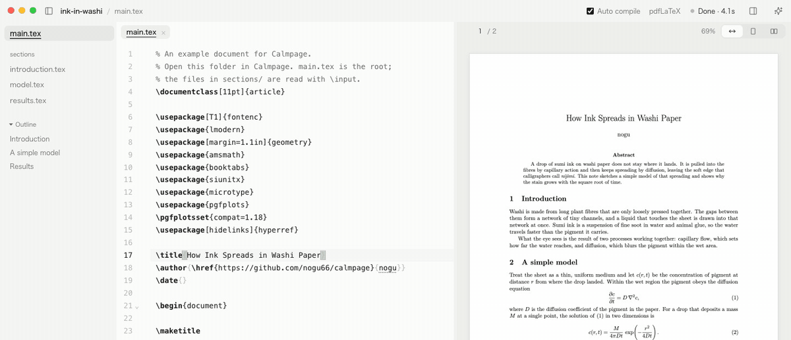

<p align="center">
  
</p>

<h1 align="center">Calmpage</h1>

<p align="center">
  A quiet LaTeX editor for macOS. Write on the left, see the PDF on the right, in one window.
</p>

<p align="center">
  <a href="https://github.com/nogu66/calmpage/actions/workflows/ci.yml"></a>
  
  <a href="LICENSE"></a>
</p>

<p align="center">
  English · <a href="README.ja.md">日本語</a>
</p>

<p align="center">
  <picture>
    <source media="(prefers-color-scheme: dark)" srcset="docs/images/calmpage-dark.png" />
    
  </picture>
</p>

> [!NOTE]
> Calmpage is in early development. It runs on macOS and has been tested on Apple silicon.

## Why Calmpage

Calmpage is a LaTeX editor that stays out of your way. The name says what it aims for: a calm page to write on.

- **Your TeX, as it is.** Calmpage compiles with the `latexmk` you already have and respects your `.latexmkrc`, so existing projects work without changes. Calmpage itself uploads nothing.
- **One window, no setup.** Open a folder and start writing. The PDF follows as you type, and SyncTeX takes you back and forth.
- **AI only if you want it.** Call the agent you prefer, such as Claude Code or Codex, with the open document as context. Or turn the AI panel off and forget it exists.

## Features

<p align="center">
  
</p>

- Editor and PDF side by side, with flicker-free recompiles that keep your scroll position
- *Auto compile*: save and compile 1.2 seconds after you stop typing
- Errors in the editor and in a Problems list
- SyncTeX both ways: ⌘J shows the cursor in the PDF, ⌘-click in the PDF jumps to the source
- A PDF viewer that works like one: clickable links (contents, `\ref`, `\cite`, URLs), text you can select and copy, search inside the PDF, page numbers, and fit width / whole page / two pages side by side
- Optional dark pages: invert the PDF in dark mode (off by default)
- Multi-file projects with `% !TEX root`, `.latexmkrc`, and automatic engine selection
- Reloads and recompiles when another editor or an agent changes a file
- Light, dark, or system appearance, with three palettes: Paper, Moss, and Sand
- English and Japanese interface

## Install

Calmpage runs on Macs with Apple silicon (macOS 12 or later).

With [Homebrew](https://brew.sh):

```bash
brew install --cask nogu66/tap/calmpage
```

Or with the install script, which puts `Calmpage.app` in `/Applications`:

```bash
curl -fsSL https://raw.githubusercontent.com/nogu66/calmpage/main/install.sh | bash
```

Update the same way: `brew upgrade --cask calmpage`, or run the script again.

You can also download the `.dmg` from the [latest release](https://github.com/nogu66/calmpage/releases/latest). The app is not notarized by Apple yet, so macOS blocks a downloaded `.dmg` the first time: try to open the app, then go to **System Settings → Privacy & Security** and click **Open Anyway**. Homebrew and the install script don't need this step.

### Build from source

You need [Node.js](https://nodejs.org) 22 or later:

```bash
git clone https://github.com/nogu66/calmpage.git
cd calmpage
npm install
npm run dist      # creates release/mac-arm64/Calmpage.app
```

### TeX

To compile documents, Calmpage needs a TeX distribution with `latexmk` and `synctex`, such as [MacTeX](https://www.tug.org/mactex/) (`brew install --cask mactex-no-gui`). It finds TeX in `/Library/TeX/texbin` and other tools in your login shell's `PATH`, so it works when opened from Finder.

## Usage

Open a folder (or a single `.tex` file) with ⌘O. Calmpage finds the root document and compiles it. To try it out, open [`examples/sample`](examples/sample), a short paper split across several files.

| Action | Shortcut |
| --- | --- |
| Open a folder or `.tex` file | ⌘O |
| Save and compile | ⌘S (automatic with *Auto compile*) |
| Compile | ⌘R |
| Show the cursor position in the PDF | ⌘J |
| Jump from the PDF to the source | ⌘-click in the PDF |
| File list | ⌘B, or the button at the left of the title bar |
| Problems | ⇧⌘M |
| Show or hide the PDF preview | ⇧⌘P, or the button at the right of the title bar |
| AI panel | ⇧⌘L, or the button at the right of the title bar |
| Zoom the PDF in / out / fit to width | ⌘= / ⌘- / ⌘0 |
| Find in the PDF | ⌥⌘F, or ⌘F while the PDF has focus (⏎ next, ⇧⏎ previous) |
| Previous / next page | ← / → while the PDF has focus, or type a number in the bar above the PDF |
| Follow a link in the PDF | Click it (⌘-click still jumps to the source) |
| Settings | ⌘, or the gear at the bottom left |
| Open the PDF in Preview | ⇧⌘O |

### How Calmpage compiles

- **Root document.** `% !TEX root = …` wins. Otherwise a file with `\documentclass` is its own root. Otherwise Calmpage uses the root that last included the file, or searches for a document that `\input`s it.
- **With `.latexmkrc`**, the folder is compiled exactly as configured (engine, output directory, `TEXINPUTS`).
- **Without one**, Calmpage picks the engine: LuaLaTeX for `ltjs*` classes, `luatexja`, or Japanese text; upLaTeX for `js*` classes; XeLaTeX for `fontspec`; pdfLaTeX otherwise. Intermediate files go to `~/Library/Application Support/Calmpage/build/`, so your folder stays clean.

## AI panel

The AI panel is optional. Open it with ⇧⌘L or the button at the right of the title bar. If you don't use AI, turn off **Settings → AI panel**: the button, the menu item, and the agent settings disappear. Even with the panel on, no agent starts until you open it.

<!-- Screenshot goes here: the AI panel showing a diff with Allow / Reject. -->

- **Any [ACP](https://agentclientprotocol.com) agent.** Agents that speak the Agent Client Protocol run in Calmpage's own thread view, as in Zed. Claude Code and Codex are built in and use your existing `claude` / `codex` login (or `ANTHROPIC_API_KEY` / `OPENAI_API_KEY`). Add others from the ACP registry in **Settings → Agents**.
- **Context with every message.** Chips above the thread send the current file and selected lines, compile errors, and the PDF page you are looking at. Click a chip to leave it out.
- **You approve every edit.** Before an agent changes a file, Calmpage shows the diff with *Allow* / *Reject*. Changed files reload and compile again.
- **A real terminal, too.** *Terminal* opens your login shell in the panel, in the open folder. Run `claude` there to use every Claude Code command, or any other CLI. Agents without ACP support can also be added as terminal agents.

## Privacy

- Calmpage collects no analytics and sends nothing about you or your documents anywhere.
- Your documents are compiled on your Mac with your own TeX.
- AI agents run locally under your own accounts. What they send to their providers is governed by those agents and providers.
- Calmpage itself goes online only to read the ACP registry when you browse it in Settings. Built-in agents are fetched with `npx`, which contacts the npm registry.

## FAQ

**How is this different from Overleaf?**
Overleaf runs in the browser and compiles on its servers. Calmpage is a Mac app that compiles locally with your own TeX installation and keeps your files on your disk.

**Do I need AI to use Calmpage?**
No. Turn off **Settings → AI panel** and Calmpage is a plain editor with a PDF preview.

**Does it run on Windows or Linux?**
Not yet. Calmpage is built with Electron, so ports are possible, but only macOS is tested today.

**Which TeX engines are supported?**
Whatever `latexmk` can run: pdfLaTeX, XeLaTeX, LuaLaTeX, upLaTeX, and others through `.latexmkrc`.

## Contributing

Bug reports, ideas, and pull requests are welcome. See [CONTRIBUTING.md](CONTRIBUTING.md) for how to build, test, and add a language.

## License

[MIT](LICENSE)
